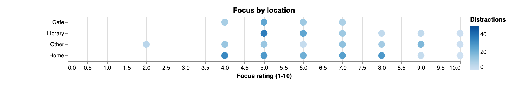
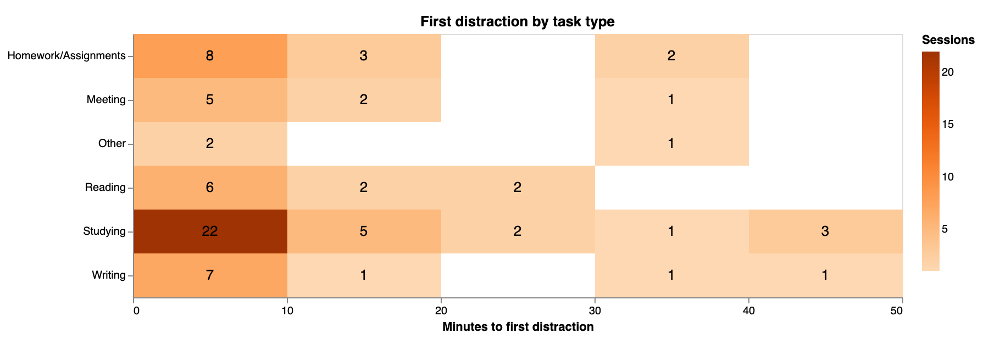
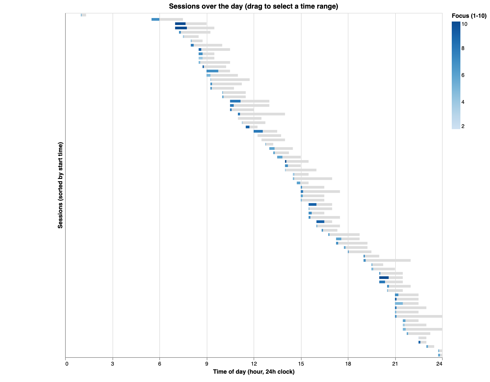
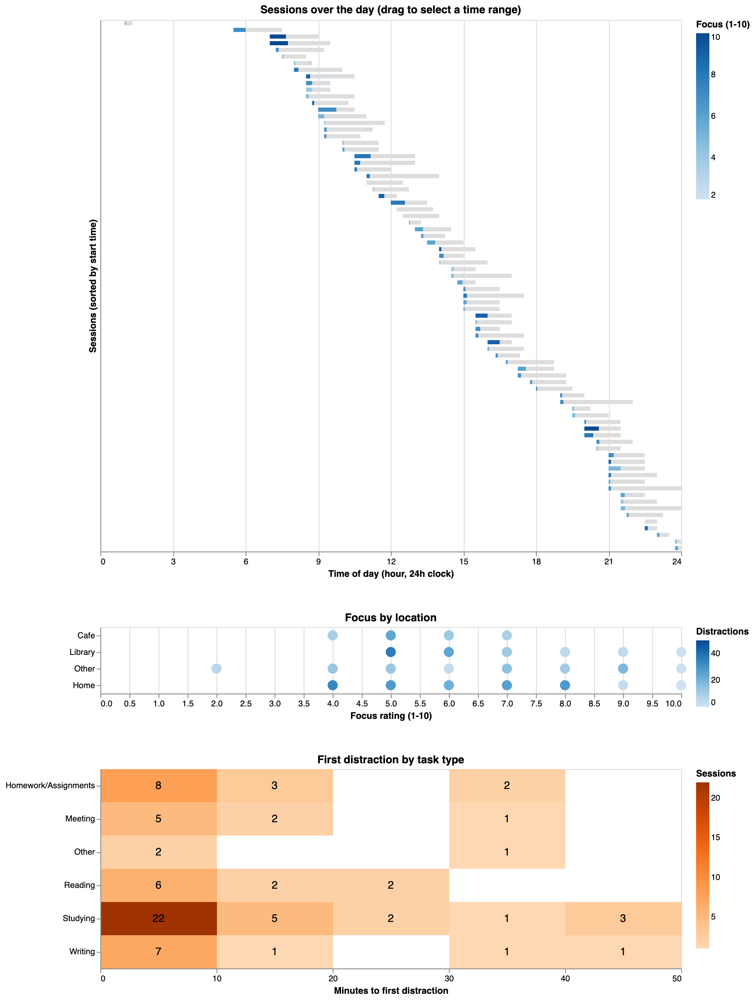
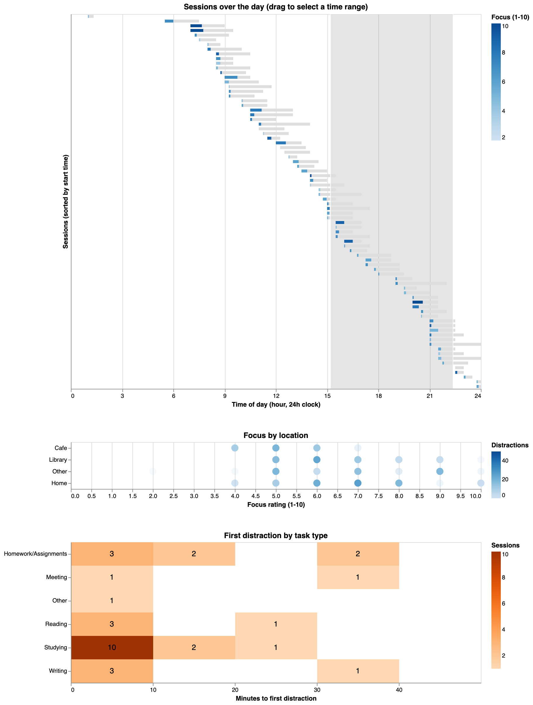
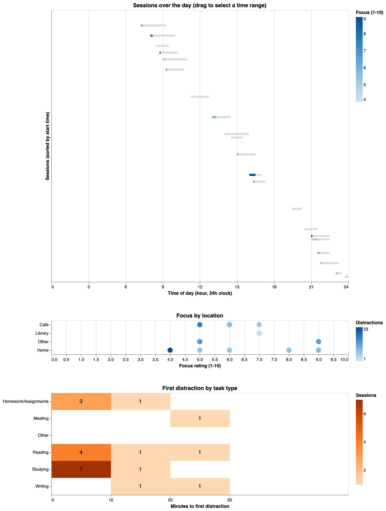
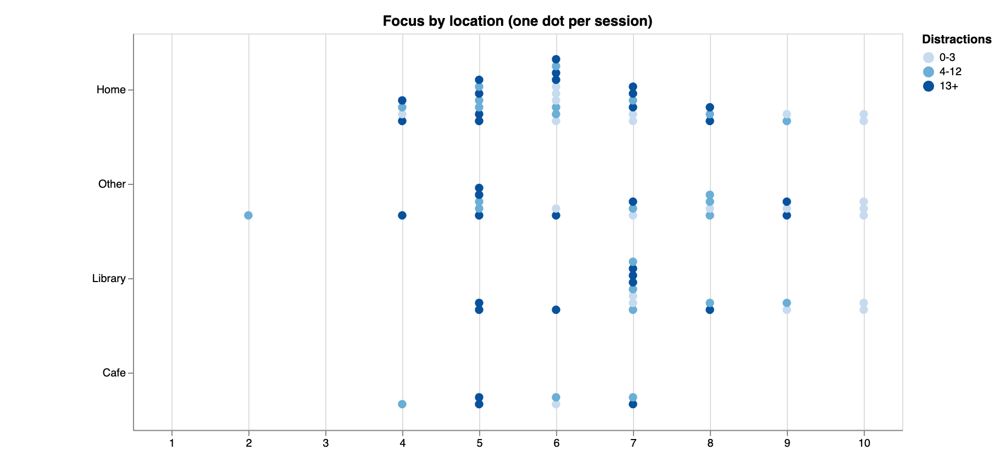
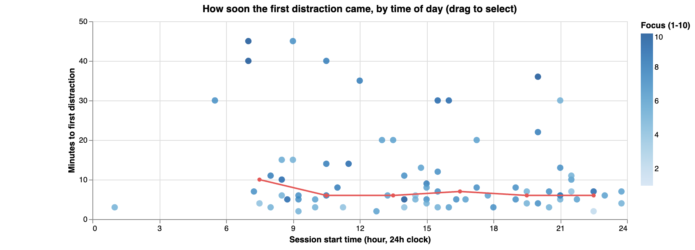
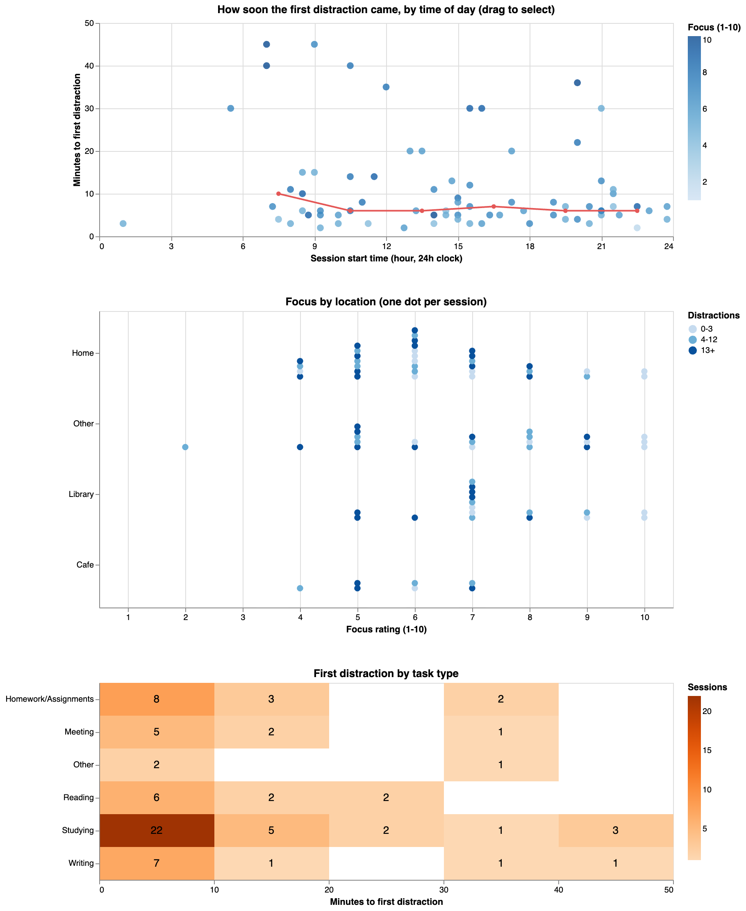
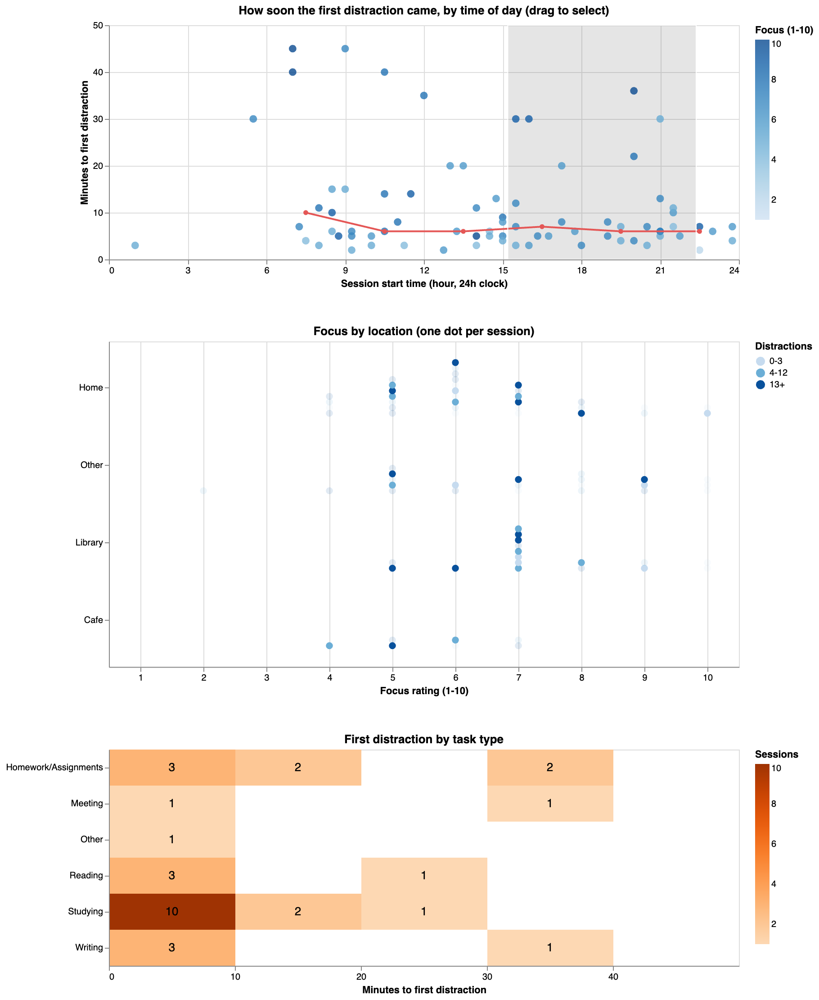

# Assignment 2: Exploring and building visualizations

## Task 1: Revisit Your Data and Questions

We're keeping the same four questions from Assignment 1, since they still hold up well with the data we have: noise and distractions/focus, task type and time to first distraction, location and focus/distractions, and sleep vs. focus. The one thing we're flagging is that task type is still heavily skewed toward "Studying," so we'll either group it into Studying vs. Non-studying or keep it as is and call out the imbalance when we discuss results.

Looking back at the dataset, we found a few things worth fixing before analysis. The following cleaning and changes will be made:

- Clean the sleep column into one consistent hours format, since it currently mixes hours and minutes in different styles ("7", "420", "7 hours")
- Add an actual session duration column, calculated from start and end time, to compare against planned duration
- Convert distraction count into a rate (distractions per minute) instead of a raw count, so sessions of different lengths can be compared fairly

One real limitation we're keeping as-is: our form only captures the time of the first distraction, not every distraction in a session, so anything involving distraction patterns or clustering is out of scope for this round.

## Task 2: Data Preparation

All transformations are in [`notebooks/Task2_DataCleaning.ipynb`](notebooks/Task2_DataCleaning.ipynb), which turns the raw Google Form export (`data/form_responses.csv`) into `data/cleaned_data.csv`. Running the notebook from top to bottom reproduces the cleaned file.

- **Renamed columns.** Long form questions became short names (e.g. `Sleep_Hours`, `Focus_Rating`).
- **Parsed messy free-text numbers.** Planned duration, time to first distraction, sleep and phone screen time came in mixed formats ("90min", "3 hours", "480", "Around 30"). A small parser converts them to one unit (minutes, or hours for sleep). Invalid entries like "Option 1" are marked missing instead of being misread as numbers.
- **Fixed dates and times.** A typed date of `12/9/2000` was clearly wrong, so the form's auto-logged timestamp is used as the session date. Start and end times were converted to 24-hour format.
- **Added `Total_Duration_Minutes`.** Computed from start and end time, with midnight crossing handled. Sessions over 5 hours get `Duration_Flag_Long` for review instead of being changed silently.
- **Standardized categories.** Task type, location, noise level and caffeine were mapped to the options on the form, and anything else became "Other". "Meetings" and "Meeting" were merged.
- **One-hot encoded focus strategies.** People could choose several strategies per session, so each strategy became its own 0/1 column.
- **Extracted effectiveness.** The number was pulled from labels like "3- Moderately effective".
- **Filled missing values and flagged them.** Sleep was filled with 7 h, screen time with 0, and planned duration with the median. Missing categorical answers became "None". `_imputed` columns mark filled values so they can be excluded from analyses such as sleep vs. focus. Real zeros, such as no distractions, were left alone.

## Task 3: Exploratory Data Analysis

The exploration is in [`notebooks/Task3_EDA.ipynb`](notebooks/Task3_EDA.ipynb), which uses `data/cleaned_data.csv`.

- **Group sizes are uneven.** Only 3 sessions were "Noisy" and 7 were at a café, so those groups are too small to compare reliably. "Noisy" was left out of the noise plot. "Other" location (22 sessions) mixes offices, campus and transit.
- **Noise vs. distractions (Fig 1).** Quieter did not mean fewer distractions. "Quiet" had the lowest median (7.5), and "Very Quiet" was higher (12.5). Noise alone doesn't explain distractions.
- **Focus by location (Fig 2).** The library had the highest mean focus (7.4) and the café the lowest (5.7). A crosstab showed that location and noise overlap: every café session was Moderate or Noisy, and the library was mostly Quiet or Very Quiet. We can't separate their effects, so we now treat them together as "environment".
- **Sleep vs. focus (Fig 3).** There was no clear relationship (Spearman ≈ 0.11). Location, shown by color, separated focus more than sleep did, so sleep is now a lower-priority question.
- **Planned vs. recorded duration (Fig 4).** This was a data check. Six sessions show 5–15 hour lengths (e.g. 21:00 → 09:25), which look like AM/PM entry errors. They are excluded from any duration analysis.
- **Collection caveats.** All ratings are self-reported by different people on their own scales, and some values are imputed. Small differences between groups shouldn't be over-read.

## Task 4: Implement visualization alternatives

We made three different charts in Vega-Lite (`vis/index.html` and `vis/charts.js`). Each one is for a different question, and we made them look different on purpose so we weren't just making the same chart three times. We first built them on the raw form responses (22 sessions at the time), pulling numbers out of answers like "90min" right in the chart code. After Task 2 we switched them to `data/cleaned_data.csv`, which has 80 sessions, and the screenshots below are from that version. Having almost four times as much data changed how well each chart worked.

### 1. Focus by location (dot plot)

This one comes from our location sketch in Assignment 1. It's for the question of how focus and distractions change depending on where you work. It uses `location`, `focus`, and `distractions`. Every session is a circle. The row shows the location, how far right it is shows the focus rating, and a darker circle means more distractions. We wanted to see every single session instead of an average.

With the small raw data this kind of worked, but with 80 sessions it mostly doesn't. The cleaning grouped locations into just four (Home 34, Other 22, Library 17, Cafe 7), and focus is a whole number from 1 to 10, so tons of sessions land on the exact same spot. 80 sessions show up as only 25 circles, and Home's 34 sessions look like 7. Our hand sketch didn't have this problem because we drew the circles next to each other. The colors are also hard to read because a few sessions had 30 to 50 distractions, so most circles look like the same light blue. We're keeping the idea of showing every session by location, but the circles need to be spread out or stacked so you can actually count them.

### 2. First distraction by task type (heatmap)

This is based on our heatmap sketch, but we put task type on the rows instead of difficulty. It's for the question of whether people get distracted sooner on some kinds of tasks. It uses `task_type` and `first_distraction` (in minutes). Each box is a 10-minute chunk for one task type, and a darker box means more sessions landed there. We also put the number in each box because it was hard to tell the exact count from the color.

This chart got a lot better with more data. With the raw data most task types had one or two sessions, so the rows were mostly empty. Now every task type has at least a few sessions, and the pattern is easy to see: 50 of the 77 sessions that had a distraction got distracted in the first 10 minutes, and studying is the clearest with 22 of 33 in that first box. The "Other" row still only has 3 sessions, so we don't read much into it. The 3 sessions with no distractions aren't on here because they don't have a time. We're keeping this one.

### 3. Sessions over the day (timeline)

This one came from our time-of-day timeline sketch. It's for a question we didn't really look at in Assignment 1, which is whether the time of day changes how long someone stays focused. It uses `start_time`, `planned` duration, `first_distraction`, and `focus`. Each session is a bar placed at the time of day it started. The grey bar is how long they planned to work, the blue part is how long until the first distraction, and darker blue means they rated their focus higher.

We tried this because the other two charts don't show time at all, and it lets you compare the first distraction to the planned length for every session at once. That part worked well. Every distracted session got its first distraction within the first half of what they planned, and most within the first third. You can also see when people actually work. 50 of the 80 sessions start between 7 AM and 5 PM, 20 start at 8 PM or later, and only one starts before 5 AM. There are some problems though. With 80 sessions the rows got really thin, so we had to hide the session labels. Short sessions are tiny on a 24-hour axis. Two late sessions run past midnight and get cut off at the edge. Also, 20 sessions didn't have a usable planned time, so the cleaning filled those in with the median, which means some grey bars are estimates. We think this is the most promising of the three, but it needs a better scale and a way to handle the late-night sessions.

## Task 5: Interaction and multiple views

After Task 4 we had three separate charts that each showed one thing. The problem was that our questions connect to each other. If you notice something on the timeline, like the late sessions, you want to know where those sessions happened and how focused people were, and with three separate charts you'd have to match up session numbers by hand. So we put all three charts on one page and linked them. We only added two interactions, and each one is there for a reason.

**Selecting a time range (linked views).** You can drag across the timeline to pick a part of the day. The location chart fades out every session that isn't in that range, and the heatmap recounts using only the sessions you picked. This lets someone ask things like "what do evening sessions look like?" and see the answer in all three charts at once. In the screenshot below we selected about 3 PM to 10 PM, which is about 37 of the 80 sessions. The location chart shows those sessions were mostly at home and the library, and the heatmap shows that even in the evening, studying sessions still mostly got distracted in the first 10 minutes. Double-clicking the timeline clears the selection.

We made the location chart fade instead of hiding the other sessions because you still want to see the selected ones compared to everything else. The heatmap is different. It shows counts, so fading doesn't make sense there, and it just recounts.

In Task 4 we said the heatmap wasn't great on its own because most task types only have a few sessions. We kept it on the page anyway because it's more useful once it's linked. Instead of trying to compare every task type at once, you can pick a time range or a noise level and see when the first distraction happened for just those sessions.

**Filtering by noise level.** There's a dropdown under the charts for Very Quiet, Quiet, Moderate, or Noisy, and picking one filters all three charts to those sessions. Noisy only has 3 sessions, so it's not worth much on its own. We added this because noise was one of our original questions and none of the three charts shows noise on its own. This way we didn't need a fourth chart for it. Below is what it looks like with Moderate selected. There are 21 moderate sessions, and about half of them were at home.

**Hovering.** Every chart also shows the details of a session when you hover over it, like the task, start time, and focus rating. We kept this because the charts only use a few columns each, and sometimes you want to check the rest without leaving the chart.

**What we decided not to add.** We thought about a dropdown to change what the colors mean (focus, distractions, or effectiveness), but we couldn't think of a question it would help answer, so we left it out. We also didn't add zooming. All 80 sessions still fit on one screen, but the timeline rows got pretty thin once we switched to the cleaned data, so this might be worth adding later.

**A problem we ran into.** The first time we added the noise filter, the rows in each chart disappeared when they had no sessions, so the charts kept changing size and the title of the top chart got cut off. We fixed it by keeping every session, location, and task type on the axes all the time, even when they're empty. It also turned out better this way, because now you can see which places and tasks have nothing at that noise level instead of them just vanishing.

One thing we're still not sure about is whether people will figure out that they can drag on the timeline. Right now there's just a line of text at the top telling them. That's something we want to check in Assignment 3.

## Task 6: Visualization Refinement and Design Iterations
**Objective:** The primary goal of this design phase was to transform the FocusTrace dashboard from simple chart into an intuitive, multi-layered exploratory tool. We wanted to uncover the complex, three-way relationship between where a person studies, the background noise level of that environment, and their overall focus rating. 

Instead of making changes like the font size, color, repositing legends. I made a structural change. I moved from a single, cluttered chart to a connected two-part dashboard. By pairing a session-level dot plot (to see every single study session) with an aggregated heatmap (to see the big picture), users can spot overall trends instantly without losing the ability to dig into individual days. 

### 2)	Iteration1: Redesigning the Focus by Location Dot Plot
**Problem Identified:** In the original dot plot (Figure 1), the data points sat perfectly on top of one another along rigid vertical gridlines. This created a major visual like; a single isolated study session looked the same as ten different sessions stacked directly underneath it. For example, under the Library Category, there appears to be just a single point sitting at a focus rating of 9, completely hiding whether that rating happened once or dozen times. The true volume and density of data were completely hidden from the user.

**Figure 1: Focus Ratings By Locations**

**The problem.** Every session was one circle at its focus rating, so if two sessions at the same place had the same rating, the circles landed right on top of each other. With 80 sessions this got really bad. You could only see 25 circles, and Home's 34 sessions looked like 7. The whole point of this chart was to show every session instead of an average, and it wasn't doing that anymore. The colors were bad too. Distractions went from 0 to 50, and that one session with 50 made almost every other circle look the same light blue.

**What we changed.** Now sessions with the same place and focus rating stack on top of each other, so every session gets its own dot. This is pretty much what we drew in our Assignment 1 sketch, where the circles were side by side. We also changed the colors from a 0 to 50 scale to just three groups: 0-3, 4-12, and 13+ distractions. We picked those cutoffs so each group has about the same number of sessions (23, 25, and 32).

**Why.** Now you can actually count how many sessions each place has and see where they bunch up. Home is mostly between 5 and 7, and the library has more sessions at 7 and up. The three color groups also show something the old colors hid. Sessions rated 9 or 10 are mostly light (10 out of 14 had 0-3 distractions), and sessions rated 5 or lower are mostly dark (14 out of 23 had 13 or more). The downside is the rows got taller, because the tallest stack (Home at focus 6, with 10 sessions) sets the height for every row.

### Iteration 2: Turning the timeline into a time of day chart

**The problem.** The timeline was supposed to show whether time of day changes how fast people get distracted, but it didn't really show that. Every session was a thin bar, and with 80 sessions the rows got so thin we had to hide the labels. The part we actually cared about, the time until the first distraction, was usually only a few pixels long, because 50 of the 77 distracted sessions got distracted in the first 10 minutes. Two late sessions also got cut off at midnight. Most of the space went to the grey planned-time bars, which weren't even part of our question. And 20 of those planned times were filled in with the median during cleaning, so a lot of the grey was a guess anyway.

**What we changed.** We changed what the chart shows. Now each session is a dot. Across the bottom is when it started, and going up is how many minutes until the first distraction. So the thing we care about gets its own axis instead of being a tiny piece of a bar. We also added a red line for the median of each 3-hour block, so you can see the overall trend through all the dots. The first time we added the line, it had a big spike around 4 AM because that block only had one session, so now it only shows blocks with at least 3 sessions. The drag selection is still on this chart, so it still controls the other two.

**Why.** Now you can see the answer right on the chart. The median line is pretty flat, around 6 to 10 minutes all day, so time of day doesn't seem to change much when the first distraction happens. You can also easily spot the few people who lasted 30 to 45 minutes. We did lose the planned time vs. first distraction comparison, which was the one thing the old timeline was good at. But that wasn't one of our four questions, and a lot of those planned times were guesses, so we decided it was worth it. The 3 sessions with no distractions aren't on this chart because they don't have a time, but they still show up in the location chart.

## Task 7: Current design

Our current design is one page with three linked charts and a dropdown that filters all of them by noise level. The steps to run it are in the [README](README.md).

**What it's for.** The top chart is for whether time of day changes how fast the first distraction comes. The middle chart is for how focus and distractions change by location. The heatmap is for whether some types of tasks get interrupted sooner. The noise dropdown covers our noise question without needing a fourth chart. The main thing you do with the page is pick a group of sessions, either a time of day by dragging on the top chart or a noise level from the dropdown, and then see how that group looks by location and task type.

**Main design decisions.** We kept every session as its own dot in the top two charts, because our groups are really uneven and an average would hide that. The heatmap is the only chart that counts sessions, since it's comparing six task types at once. We used three distraction groups instead of a smooth color scale, and we only draw the median line where there are at least 3 sessions, so one session doesn't look like a pattern. The axes always keep every location and task type, even when a filter leaves them empty, so the charts don't jump around.

**How it's different from Assignment 1 and our earlier versions.** The location chart ended up close to our hand sketch from Assignment 1, but we only got there after our first coded version didn't work with the real data. The time chart changed the most. It started as a timeline of sessions over the day and turned into a scatterplot that answers one specific question. The heatmap has task type on the rows instead of difficulty. And in Assignment 1 we weren't planning to link the charts at all.

**What works well.** The heatmap shows a clear pattern, which is that most first distractions happen in the first 10 minutes for every task type. The location chart now shows every session, and you can easily see that high focus goes with fewer distractions. Dragging on the top chart is quick and the other two charts update right away.

**What we're still not sure about.**
- Whether people will figure out they can drag on the top chart. Right now there's just one line of text at the top telling them.
- Whether stacking the dots makes sense, or whether people will think a taller stack means a higher value.
- Whether having three color scales on one page is confusing, especially since two of them are blue.
- Whether people will understand the red median line without it being explained.

**What we want to test in Assignment 3.** We want to give people a few tasks, like "find the time of day when people get distracted the fastest" or "which location has the most sessions with 13+ distractions," and see if they can do them without help. That would tell us if people find the drag selection and if they read the stacked dots and colors the right way. We'd also like to compare the linked page with the three charts shown separately, to see if linking them actually helps or just makes it more complicated.
