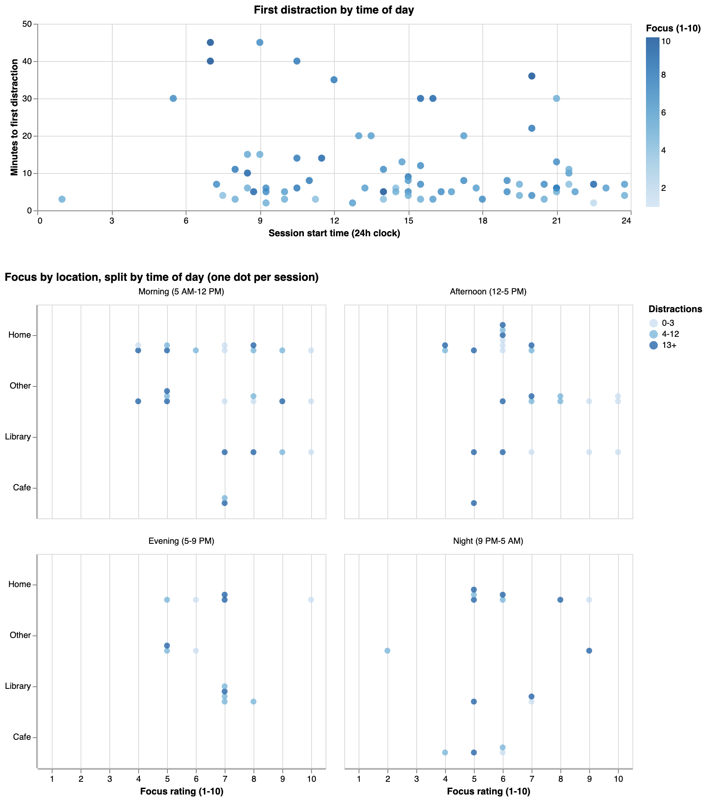
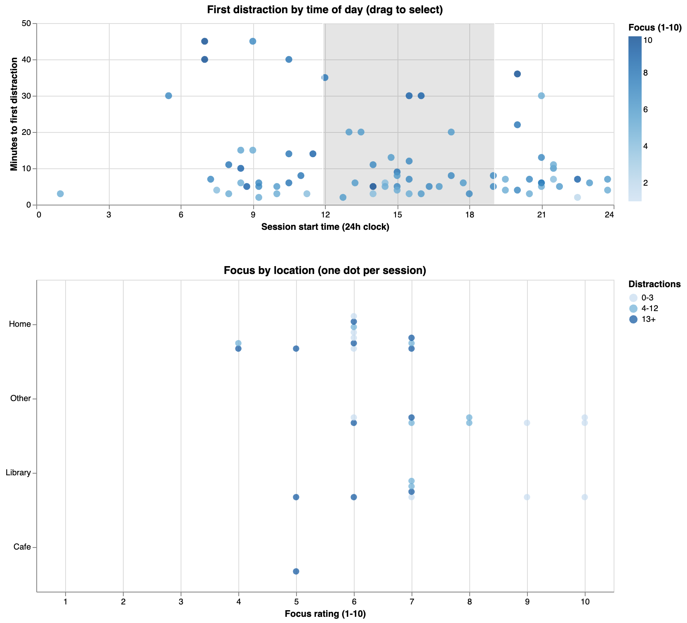

# Focus by location across the day

## Question

**Do focus and distractions at each place look different depending on the time of day?**

There are two charts. The top one shows each study session by when it started (24h clock) and how many minutes it took until the first distraction. The bottom one shows every session as a dot, with one row per location (Home, Other, Library, Cafe) and the focus rating (1-10) across. Sessions at the same place with the same rating stack on top of each other, and the color shows how many distractions the session had (0-3, 4-12, or 13+). We use all 80 sessions from `data/cleaned_data.csv`.

- **Static version:** the location chart is split into 4 panels by when the session started: Morning (5 AM-12 PM), Afternoon (12-5 PM), Evening (5-9 PM) and Night (9 PM-5 AM).
- **Interactive version:** one location chart. Drag across the top chart to pick a time range, and the location chart only shows the sessions in that range. The dots re-stack so you can still count them. Double-click to clear.




## How to run on your computer

1. Clone the repo:
   ```
   git clone https://github.com/abhawsar2004/CS424.git
   cd CS424
   ```
2. Start a local server from the `CS424` folder:
   ```
   python -m http.server 8000
   ```
3. Open in your browser:
   - Static: http://localhost:8000/a3/amithi/static/
   - Interactive: http://localhost:8000/a3/amithi/interactive/

Don't open the HTML files by double-clicking them. They need the local server to load the data.

## Hypothesis

For **T2**, where the time range covers two panels, people will be **faster and more accurate with the interactive version**, because with the static version they have to find the dots in two panels and add them up. For **T1**, which compares two single time periods, we don't expect much of a difference. The static version might even be a little faster there, because the two panels are right next to each other, while the interactive version needs two drags.

## Tasks and expected answers

Each participant answers 4 multiple-choice questions: two tasks, each in two versions (A and B). "13+ distractions" is the darkest dot color, and "rated 8 or higher" means a focus rating of 8, 9 or 10.

| Task | Variant | Question | Choices | Expected answer |
|---|---|---|---|---|
| **T1: Compare two time periods** | A | Did **Home** have more sessions with 13+ distractions in the **morning (5 AM-12 PM)** or the **afternoon (12-5 PM)**? | Morning / Afternoon | **Afternoon** (5 vs 3) |
| | B | Did **Other** have more sessions with 13+ distractions in the **morning (5 AM-12 PM)** or the **afternoon (12-5 PM)**? | Morning / Afternoon | **Morning** (4 vs 2) |
| **T2: Find the most over a longer range** | A | Between **5 AM and 5 PM**, which location had the most sessions **rated 5 or lower**? | Home / Other / Library / Cafe | **Home** (7, next is Other with 4) |
| | B | Between **12 PM and 9 PM**, which location had the most sessions **rated 8 or higher**? | Home / Other / Library / Cafe | **Other** (5, next is Library with 3) |

How the two variants match:
- T1-A and T1-B ask the same question about a different place. Both have a difference of 2, and the answers are opposite, so nobody can just repeat their first answer.
- Both T2 variants cover two panels in the static version. The differences are 3 and 2, so they're close but not exactly the same.
- T2-B has a little trap. Home has the most dots overall, but Other wins once you only count sessions rated 8 or higher.
- A few sessions start right on a cutoff (one at 12:00 and six at 9:00 PM). We checked that none of the answers change whether those get included or not, in case someone's drag is a little off.

`check_answers.py` recalculates these answers from the data. It's plain Python, so you don't need pandas:
```
python3 a3/amithi/check_answers.py
```

## Procedure

Every participant uses **both** versions: one set of questions on each.

- **Set 1** = T1-A and T2-A
- **Set 2** = T1-B and T2-B

| Participant | Uses first | Static version gets | Interactive version gets |
|---|---|---|---|
| P01, P05, P09 | Static | Set 1 | Set 2 |
| P02, P06, P10 | Static | Set 2 | Set 1 |
| P03, P07, P11 | Interactive | Set 1 | Set 2 |
| P04, P08, P12 | Interactive | Set 2 | Set 1 |

Each session takes about 10 minutes:

1. Read the instructions below to the participant.
2. First version: one practice question (not scored), then the two timed questions.
3. Second version: one practice question (not scored), then the two timed questions.

Practice question: "How many Library sessions were in the evening (5-9 PM)?"

We run 1-2 pilot participants first and fix anything confusing before the real study.

## Participant instructions

Read this out loud to every participant:

> "You'll answer four multiple-choice questions about study sessions using two versions of a chart. Each dot is one session. Answer as quickly and accurately as you can, and say your answer out loud. There's a 90-second limit per question. This is testing the chart, not you."

Before the interactive version, add:

> "You can drag across the top chart to pick a time of day. The bottom chart only shows sessions from that time. Double-click to clear."

## Measurements

For every question we record:

- **Accuracy:** correct (1) or incorrect (0).
- **Time:** seconds from when we finish reading the question until the participant says an answer.
- **Timeout:** answers longer than 90 seconds count as incorrect, with time recorded as 90.

## Recording results

All results go in `a3/results/results.csv`, one row per question (4 rows per participant), with the same columns as Angela's:

```
participant_id,order,condition,task,variant,answer,correct,time_seconds,notes
P01,static_first,static,T1,A,Afternoon,1,18.2,
P01,static_first,static,T2,A,Other,0,52.0,added the wrong panels
P01,static_first,interactive,T1,B,Morning,1,21.5,
P01,static_first,interactive,T2,B,Other,1,15.4,
```

One teammate reads the questions and times with a stopwatch, and another fills in the sheet and writes down anything noticeable in `notes` (like confusion, trouble dragging, or counting out loud).
