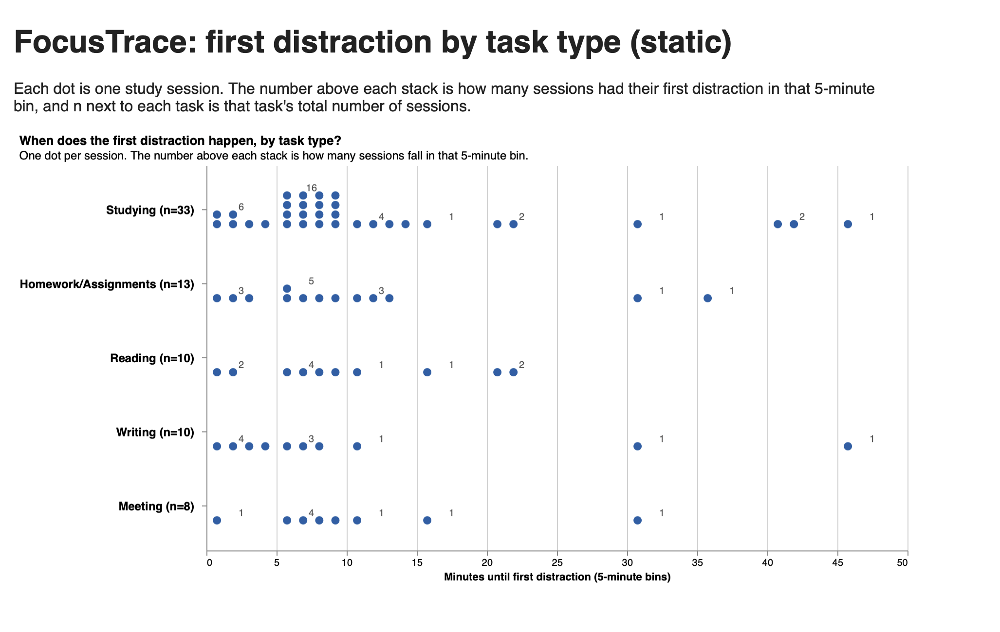

# First distraction by task type

## Question

**Do people get distracted sooner on some kinds of tasks than others?**

Each dot is one study session, placed by how many minutes passed before the first distraction (in 5-minute bins),
with one row per task type. We use the 74 sessions that had a distraction, across the five main task types.

- **Static version:** the dot chart, with the number of sessions above each stack and the total (n) next to each task.
- **Interactive version:** the same dot chart. Drag across it to pick a time window, and a bar chart shows what %
  of each task's sessions were first distracted inside that window.




## How to run on your computer

1. Clone the repo:
   ```
   git clone https://github.com/abhawsar2004/CS424.git
   cd CS424
   ```
2. Start a local server from the `CS424` folder:
   ```
   python -m http.server 8000
   ```
3. Open in your browser:
   - Static: http://localhost:8000/a3/angela/static/
   - Interactive: http://localhost:8000/a3/angela/interactive/

Don't open the HTML files by double-clicking them. They need the local server to load the data.

## Hypothesis

People will answer **faster and more accurately with the interactive version**, because it calculates the
percentages for them. With the static version they have to count dots and divide by n themselves.

## Tasks and expected answers

Each participant answers 4 multiple-choice questions: two tasks, each in two versions (A and B).

| Task | Variant | Question | Expected answer |
|---|---|---|---|
| **T1: Compare two task types** | A | Which had a larger share of its sessions first distracted between **15 and 29 minutes**: Reading or Studying? | **Reading** (30% vs 9%) |
| | B | Which had a larger share of its sessions first distracted between **0 and 4 minutes**: Writing or Studying? | **Writing** (40% vs 18%) |
| **T2: Find the highest** | A | Which task type had the highest share of its sessions first distracted between **10 and 14 minutes**? | **Homework/Assignments** (23%) |
| | B | Which task type had the highest share of its sessions first distracted between **5 and 19 minutes**? | **Meeting** (75%) |

`check_answers.py` recalculates these answers from the data.

## Procedure

Every participant uses **both** versions: one set of questions on each.

- **Set 1** = T1-A and T2-A
- **Set 2** = T1-B and T2-B

| Participant | Uses first | Static version gets | Interactive version gets |
|---|---|---|---|
| P01, P05, P09 | Static | Set 1 | Set 2 |
| P02, P06, P10 | Static | Set 2 | Set 1 |
| P03, P07, P11 | Interactive | Set 1 | Set 2 |
| P04, P08, P12 | Interactive | Set 2 | Set 1 |

Each session takes about 10 minutes:

1. Read the instructions below to the participant.
2. First version: one practice question (not scored), then the two timed questions.
3. Second version: one practice question (not scored), then the two timed questions.

Practice question: "How many Writing sessions were first distracted in 5–9 minutes?"

We run 1–2 pilot participants first and fix anything confusing before the real study.

## Participant instructions

Read this out loud to every participant:

> "You'll answer four multiple-choice questions about study sessions using two versions of a chart. Each dot is
> one session. Answer as quickly and accurately as you can, and say your answer out loud. There's a 90-second limit
> per question. This is testing the chart, not you."

Before the interactive version, add:

> "You can drag across the chart to select a time window. The bars on the right update. Double-click to clear."

## Measurements

For every question we record:

- **Accuracy:** correct (1) or incorrect (0).
- **Time:** seconds from when we finish reading the question until the participant says an answer.
- **Timeout:** answers longer than 90 seconds count as incorrect, with time recorded as 90.

## Recording results

All results go in `a3/results/results.csv`, one row per question (4 rows per participant):

```
participant_id,order,condition,task,variant,answer,correct,time_seconds,notes
P01,static_first,static,T1,A,Reading,1,24.3,
P01,static_first,static,T2,A,Studying,0,61.0,picked the row with most dots
P01,static_first,interactive,T1,B,Writing,1,9.8,
P01,static_first,interactive,T2,B,Meeting,1,14.2,
```

One teammate reads the questions and times with a stopwatch; another fills in the sheet and writes down anything
noticeable in `notes` (confusion, trouble dragging, doing math out loud).  participant learns to brush.
- **Timing:** starts when the question is read aloud and stops when the participant states the answer.
- **Time limit:** 90 seconds per question. A timeout is scored incorrect with time = 90 s and `notes = timeout`.
- **Recording:** results go into `a3/results/results.csv` (same columns already in the repo). Optionally ask for
  confidence on a 1-5 scale after each answer.

## Curio (extra credit)

The same dataflow, run on a local clone of Curio:

1. CSV loader node for `cleaned_data.csv`.
2. Python node that does the filter and bin columns from `shared.js`.
3. Vega-Lite node for the dot strip with the interval brush.
4. Curio interaction node that passes the selection to a second Python node, which recomputes the share per task.
5. Bar chart node for the shares.

Screenshots and a short screen recording of the brush go in `a3/angela/curio/`.
